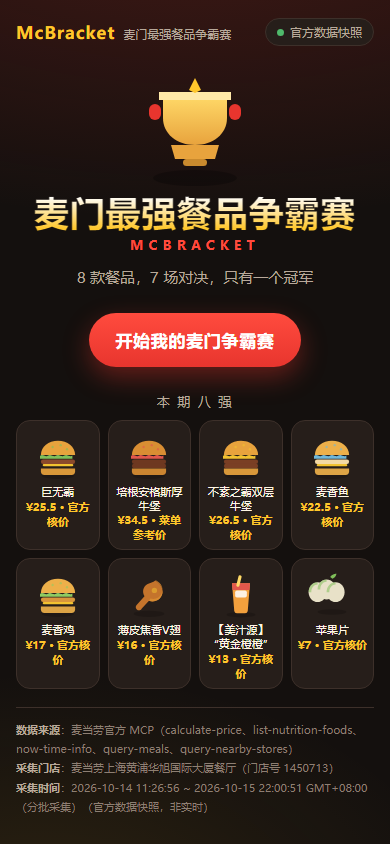
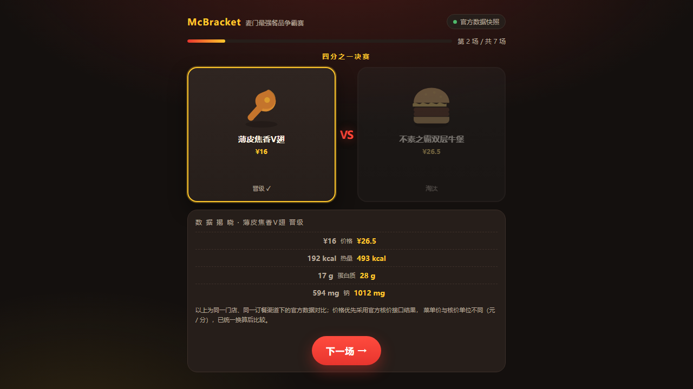
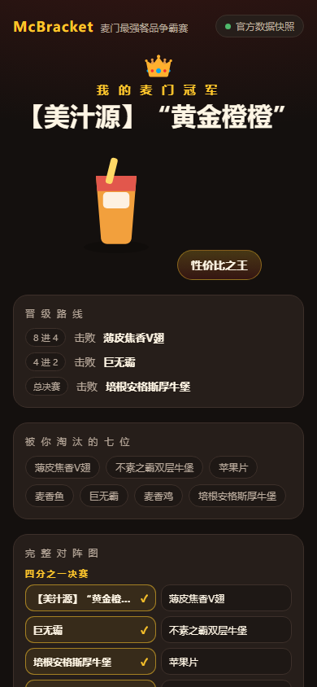
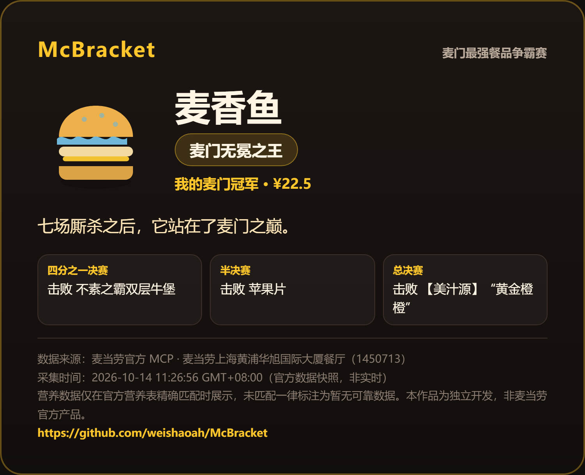

# McBracket · 麦门最强餐品争霸赛

**8 款真实麦当劳餐品，7 场一对一对决，只有一个冠军。**

选出你心中的麦门最强，生成可分享的冠军卡——菜单价格与营养数据全部来自
[麦当劳官方 MCP](https://github.com/M-China/mcd-mcp-server)，不是静态换皮游戏。

这是「麦当劳中国程序员创意开发大赛」的参赛作品，由个人独立开发，**非麦当劳官方产品**。

## 试玩

| 方式 | 说明 |
|---|---|
| 在线 Demo | GitHub Pages（仓库公开后开启，见下方「部署」），无需 Token、无需注册 |
| 本地运行 | `npm install && npm run dev`，打开 http://127.0.0.1:5173/ |

## 三步玩法

1. **开始争霸赛** —— 8 款餐品自动随机抽签进入淘汰赛对阵。
2. **7 场对决** —— 每场点选你更喜欢的一款：四分之一决赛 4 场 → 半决赛 2 场 → 总决赛 1 场。每场选择后揭晓两款的价格、热量、蛋白质、钠对比。
3. **加冕冠军** —— 查看晋级路线、完整对阵图，一键导出竖版冠军卡 PNG 发朋友圈。

## 截图

| 首页 | 对决与数据揭晓 |
|---|---|
|  |  |

| 冠军页与对阵图 | 导出的冠军卡 PNG |
|---|---|
|  |  |

## 数据从哪里来（重要）

页面展示的每一项数据都有明确来源，且**三种状态严格区分**：

- **官方实时查询**：`scripts/fetch_snapshot.py` 通过 MCP 实时调用 `query-nearby-stores`、`query-meals`、`calculate-price`、`list-nutrition-foods`、`now-time-info`（全部只读）。
- **官方数据快照**：Demo 模式使用 `src/data/snapshot.json`，由官方 MCP 只读采集「麦当劳上海黄浦华旭国际大厦餐厅（1450713）」，时间戳取自官方 `now-time-info`（GMT+08:00）。页面明确标注「官方数据快照，非实时」。
- **暂无可靠数据**：营养数据只采用官方营养表与菜单名的**精确匹配**结果；匹配不上就如实显示「暂无可靠数据」，绝不编造或估算。

已知的数据陷阱及处理方式（实测踩坑）：

- `query-meals` 的价格单位是**元**（字符串 `"25.5"`），`calculate-price` 的单位是**分**（整数 `2550`）。两者已统一换算为分后比较。
- **菜单按营业时段切换**：`query-meals` 返回的是当前时段菜单。实测早餐时段（09:28）门店 95 个在售商品中，8 强只有饮料 1 款在售——汉堡和小食不是下架，而是这个时段本就不供应。因此快照支持**分批采集合并**，每条数据保留各自的采集时间，页面显示时间区间而非单一时刻。
- 营业时间外门店菜单会缩水（实测 23:59 后 8 强中 3 款下架、核价接口不可用），此时快照缺项而不是猜测。
- 快照中的价格对比仅在同一门店、同一订餐渠道（orderType=1, beType=1）下成立。
- 价格优先使用 `calculate-price` 官方核价，不可用时降级为 `query-meals` 菜单价并在快照中标注 `priceSource`。当前 8 强中 2 款已通过核价验证（巨无霸 ¥25.5、美汁源 ¥13.0，与菜单价一致）。

详见 [MCP_INTEGRATION.md](MCP_INTEGRATION.md)。

## 安装与本地运行

```bash
npm install
npm run dev        # http://127.0.0.1:5173/
npm run test       # Vitest：淘汰赛规则与金额展示的 11 条测试
npm run build      # 类型检查 + 产物构建（GitHub Pages 可直接部署 dist/）
```

可选：用你自己的 Token 刷新数据快照（Token 只走环境变量，绝不入库）：

```bash
export MCD_MCP_TOKEN=你的Token
python scripts/fetch_snapshot.py --city 上海 --keyword 人民广场 --out src/data/snapshot.json
```

## 真实接入的证据

- `scripts/fetch_snapshot.py` 是自包含的 MCP 客户端（标准库 urllib，零第三方依赖），实际调用了 5 个只读 Tool，并在写入类工具上设置了硬性拒绝（`create-order` 等一旦出现在调用列表即抛错）。
- 2026-10-14 23:59:25 的实跑记录：门店 1450713 返回 5/8 款在售，其中巨无霸菜单价 ¥25.5、官方核价 2550 分，两者一致。
- 冠军卡由 html-to-image 在浏览器内真实栅格化生成（已用自动化浏览器验证下载产物）。

## 工程结构

```
src/engine/tournament.ts   淘汰赛核心逻辑（纯函数，11 条测试覆盖）
src/engine/championTitle.ts 冠军称号（仅依据真实数据与赛果生成）
src/components/            HomeView / MatchView / DataReveal / BracketView / ChampionCard / FoodArt
src/data/snapshot.json     官方 MCP 数据快照（含门店、采集时间、工具清单）
scripts/fetch_snapshot.py  只读 MCP 采集脚本（Demo 快照的可复现来源）
scripts/verify.sh          自动化浏览器验收：完整 7 场 + 重开 + PNG 导出
```

## 安全与免责

- Token 不进入前端代码、不进入仓库；`mcp-config.example.json` 仅含 `${MCD_MCP_TOKEN}` 占位符。
- 全程只读：不接入 `create-order`、`cancel-order`、`auto-bind-coupons`、`draw-lottery` 等任何写入类工具，不代用户下单。
- 餐品视觉为原创 SVG 插画，不复制官方图片素材；本项目与麦当劳官方无关。
- 价格与营养数据仅供参考，请以麦当劳官方渠道实时结果为准。

## 部署（GitHub Pages）

`vite.config.ts` 已设置 `base: './'`，`npm run build` 产物可直接部署到
`https://<user>.github.io/McBracket/`。Demo 模式不需要任何凭证。

## License

MIT，见 [LICENSE](LICENSE)。参赛声明见 [CONTEST_DECLARATION.md](CONTEST_DECLARATION.md)。
